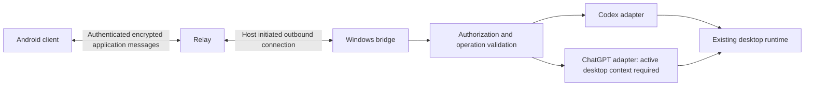

# 架构与待验证决策

状态：2026-10-28。整体架构仍为提议；独立恢复实验与固定版本桌面适配已分别验证，尚未串接成远端产品。

## 组件与边界

- Android：原生交互、有限历史缓存、文件选择、审批详情、有效设置和连接状态。
- Bridge：配对、设备授权、操作校验、桌面适配、事件缓冲、恢复协调和脱敏审计。运行在实现所需的最低 OS 权限下。
- Relay：设备路由、在线连接和资源限额。目标是只转发端到端密文；元数据可见范围、保留期和访问控制需明确。
- Desktop runtime：原会话、任务执行、模型访问、沙箱、插件和账户凭据的权威来源。

电脑与手机优先主动连接中继；暂不要求公网入站或占用 Android VPN。直连是后续可选优化。官方 Remote 也使用中继，本方案的稳定性收益必须通过实测确认。

## 接口边界

官方 app-server 文档提供 Codex thread、turn、审批和 model/list 能力。新启动的服务不代表桌面原运行时；本机进一步验证了桌面 App Tools 和 owner/follower 两条内部路径，详见[真实控制报告](results/2026-10-28-desktop-runtime-control.md)。优先受支持的本地接口；不以数据库写入、复制令牌或注入桌面进程作为默认适配手段。

当前 Codex follower 可独立读取快照、发文本和处理限定命令审批。ChatGPT 历史和发消息可通过 App Tools，但依赖真实有效的活动桌面任务上下文。两者分别实现，不能用 Codex 成功替代 ChatGPT 常驻验证。内部协议固定安装版本，更新后需重新验证；尚无安装版本自动门禁。

桌面适配代码目前仅供本地授权实验，没有连接到 `prototype/` 的 mTLS listener。整合时由恢复层管理设备身份、会话授权、单写入和持久操作记录，再调用 typed adapter；不能直接将内部命名管道代理给手机。

Bridge 暴露明确的业务操作，不提供任意 RPC、任意 shell 或任意路径文件访问。接口授权与模型运行时权限分别落实；允许发消息本身也可能启动有外部副作用的工具。

## 安全设计要求

- 短时、单次配对凭据，电脑明确确认，绑定双方设备身份。设备私钥在适用的系统密钥存储中保存。
- 采用成熟的双向认证和端到端加密协议及库；双端到中继的 TLS 本身不能证明端到端保密。
- 电脑端限制查看、交互和执行授权能力，可按项目/会话收窄；授权变更具备明确生效时间与范围。
- 审批绑定设备、会话、轮次、操作内容、有效期和唯一标识，处理时原子校验状态。
- 上传使用受控目录和真实路径校验；处理 junction/符号链接、覆盖和临时文件；正文与可信审批面板隔离。
- 日志、通知和诊断不记录令牌、真实正文与附件内容；APK 和代理的签名更新机制在分发前落实。

## 恢复语义

- Bridge 的事件序列属于自己的持久恢复层；不假定上游 app-server 原生提供可靠事件重放。
- 客户端携带同步位置；保留期内补齐，记录缺失时拉取权威快照。历史分页游标与实时事件序号分别处理。
- 操作 ID 与幂等记录应在必要的信任边界内持久化，记录有效期、结果和可查询状态。
- Bridge 与上游间若缺少幂等契约，崩溃可能发生在上游已执行但 Bridge 未记录结果之间。此时标记结果未知并核对，不盲目重发，不承诺任意外部副作用 exactly-once。
- 多客户端审批和设置变更使用版本与状态校验；手机掉线不扩大权限，也不默认批准。
- 设备撤销终止新的操作与连接，并定义缓存/待发队列处理；已执行任务与已下载数据单独处理。
- 后台提醒与正文同步分开；FCM/厂商推送的可达性、隐私和系统限制需在目标手机验证。

## 决策门槛

1. 原会话接入验证通过，或明确记录缺口并由用户确认范围后，才进入完整客户端实现。
2. 连接恢复状态机、幂等边界和撤销行为验证通过，才接入真实执行审批。
3. 隔离测试与攻击用例通过后，再扩大到个人真实会话；测试通过不等于全面安全保证。

依据：[Codex App Server](https://learn.chatgpt.com/docs/app-server)、[Remote connections](https://learn.chatgpt.com/docs/remote-connections)。查阅日期 2026-10-28；实验接口需按安装版本重新核对。
