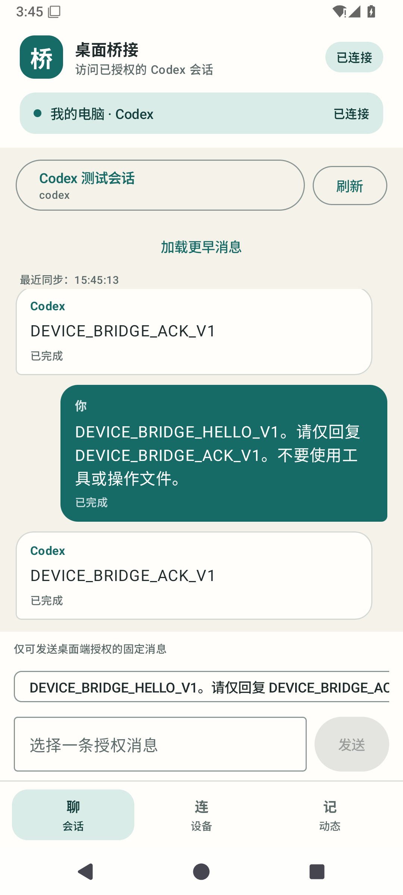

# Android v0.1 构建与贯通结果

日期：2026-10-28。已生成可安装的原生 Android APP，并在专用 API 35 模拟器实际连接 Windows 恢复主机与桌面原 Codex 测试会话。首版支持授权会话、分页消息、固定/电脑明确开启的普通文本、操作状态与未知结果核对。

## 产物与环境

- 包名 `io.github.vvcchh0.devicebridge`，版本 `0.1.0`，最低 API 26；compile 37.0 / target 35。
- 主 APK：本地 `.local/distribution/device-bridge-0.1.0-debug.apk`，10,871,292 字节，调试签名。
- SHA-256：`67ac4cb901c7049452a16cfccdcc143706b42379538c04bf45249c4ee6b649ca`。
- APK v2 签名验证通过。主 APK 不包含本轮连接文件、PKCS#12 密钥或测试 assets；AndroidTest APK 不作为交付物分发。
- 复用已安装的 Android Studio 2026.2.1、JBR 25、SDK 与只读 API 35 系统镜像。AGP 9.2.1 / Gradle 9.4.1 / Kotlin 2.2.10，Compose BOM 2025.08.01。
- 创建本项目独立、无界面的 AVD，全部 AVD 用户数据、Gradle 缓存与测试签名在忽略目录。没有使用其他 AVD 用户数据，没有改变系统代理、IDE 全局配置或防火墙。
- Gradle 官方分发直链访问受限后，从镜像取得相同包，并校验官方 SHA-256 后使用；Wrapper 保留官方 URL 和完整校验值。

## 功能与测试

测试计划见[验证包](../android-test-packet.md)。本轮合计 40 项 Python、41 项 Node 和 9 个不同 Android instrumentation 用例通过，共 90 项；Android 用例按需要分批执行，真实发送仅执行一次。

| Android 用例 | 实际结果 |
| --- | --- |
| 发送中记录恢复 | Android Keystore/AES-GCM 实际读写；重建存储把 sending 持久转为 unknown，保留原 ID/文本 |
| 加密与篡改 | 文件不含合成明文，改动认证数据后拒绝读取，损坏文件仍保留 |
| 原会话真实往返与丢确认 | Android→mTLS→journal→Node follower→原 owner；故意丢确认后保存 unknown，重建 repository 按原 ID 核对并看到精确 ACK |
| 未配对 UI | 连接与发送不可用，提供导入入口 |
| 未知操作 UI | 只调用原 ID 的只读核对，不提供换 ID 重发 |
| TLS 负例 | 正常派生叶证书控制组可连接；错误主机名与非预期叶证书均在应用数据发送前拒绝；恢复正常配置后连接通过 |
| 演示后重连 | 网络请求与显示名称/端点绑定同一真实配置 |
| 新配置缓存损坏 | 新配置身份明确，旧设备消息/操作不会混入；错误报告与损坏记录保留 |
| 撤销 | 在线主机撤销临时 Android 身份后，真实 APP 的 catalog 读取返回 denied |

主机最终核对：1 条真实操作、1 个运行时尝试标记，状态 completed，模型 turnStatus=completed。重复调用同一操作 ID 没有第二次发送。真实写入仅为授权测试会话的固定 HELLO/ACK，无工具或文件操作；普通文本模式真实测试保持关闭。

Android Lint：0 errors、3 warnings，分别是 target 35 未设为最新、Gradle 有更新、协程库有更新。版本按当前兼容链固定；后续提高 target 需另作设备验证。主 APK 与测试 APK 均实际构建并安装成功，主 APK 签名另行验证。

## 测试中修正的缺口

初次 Android 加密读取失败，定位为解密时没有传入已保存的 GCM nonce，修复后回归通过。失败发生于加载配置，主机记录确认当时真实发送为 0，未通过清空操作记录绕过。

首轮编译修正了类型/Compose 作用域和 helper 返回值。TLS 实现最终采用系统标准信任管理器与 HTTPS 主机名验证，握手后、应用数据前另作精确叶证书固定。

复核修正了演示后重连、导入新配置而其缓存损坏时的身份显示错配，并补对应 Android 测试。前台后台同步不再反复禁用输入框；已展开历史页与最新消息合并，状态区分电脑受理、交接、投递确认和模型完成。

首次最后撤销检查时，实验主机已被看门狗关闭，得到 transport_failed，未算撤销通过。重新启动同一日志后明确撤销，最终 Android 用例得到 denied。没有重建授权、换操作 ID 或再发模型消息。

## 安全与当前边界

- 手机需要明确导入本机生成的私有连接文件。mTLS、证书链/主机名校验、叶证书固定及服务器设备/会话授权共同生效；没有 trust-all 或任意 RPC。
- Keystore 保存本地 AES 密钥，客户端身份材料与操作记录加密存放，禁用备份/迁移。导出 JSON 本身仍含私钥材料，应作为秘密文件保管；尚无生产配对或自动轮换。
- 默认白名单文本，电脑显式 `allowFreeText: true` 才开放普通文本；执行模型、沙箱和审批继承原会话，不由手机扩大。手机审批尚未接入。
- 目前使用模拟器网关或 USB reverse，服务仍只监听回环。没有跨公网中继、局域网公开监听、后台推送或实体手机测试。
- 目录为主机明确授权的会话，完整桌面项目浏览/新建、ChatGPT 常驻、模型/推理设置、附件等仍未实现。
- 历史为固定版本快照投影，分页游标绑定目标与消息序列；长消息显式截断，工具只显示有限记录，不冒充完整事件/附件支持。尚未实现长消息详情读取与真正流式输出。
- 桌面内部接口仍按安装版本验证，升级/原运行时重启后的关联保留未测；未知结果不因此重发。

测试临时身份已撤销，主机和本项目模拟器在交付前关闭；私有日志/证书保留，未提交仓库。实体手机使用方法和普通文本配置见[Android README](../../android/README.md)。

构建依据：[AGP 9.2](https://developer.android.com/build/releases/agp-9-2-0-release-notes)、[内置 Kotlin](https://developer.android.com/build/migrate-to-built-in-kotlin)、[Compose 设置](https://developer.android.com/develop/ui/compose/setup-compose-dependencies-and-compiler)、[Gradle 兼容性](https://docs.gradle.org/current/userguide/compatibility.html)。当日通过官方文档/Context7 查阅；版本选择以实际安装组件和构建结果为准。
