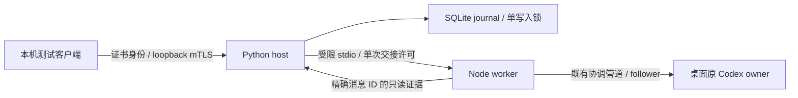

# 原 Codex 运行时与恢复层贯通结果

2026-10-28。独立 Codex follower 已接入 SQLite 恢复日志、设备授权及本机 mTLS 通路。已在授权专用会话完成一次真实发送、桥接进程崩溃、重启核对未知结果、重复提交去重和撤销验证。

## 实测范围



桌面 `26.1023.6123.0`，配套 CLI `0.165.0-alpha.1.2`，Node.js `22.22.0`，Python `3.11.2`。仅向 `Device Bridge Codex 测试` 发一条已授权固定合成消息，要求 `DEVICE_BRIDGE_ACK_V1`，没有工具或文件操作。未新建其他会话，未修改全局设置或原工作会话。

三个本项目桥接测试进程依次启动于 `127.0.0.1` 随机端口。临时证书、真实 ID、配置和 SQLite 仅在忽略的 `.local/`。计划见[测试包](../integrated-test-packet.md)，工具为 `python -m tools.integrated_desktop_test`。持久声明阻止自动重跑，不可删声明或换 ID 重发。

## 真实结果

| 验证项 | 观察 | 结果 |
| --- | --- | --- |
| mTLS → journal → follower → 原 owner | 持久保存目标、执行 ID 和用户消息 ID，Node 不继承活动任务上下文 | PASS |
| 真实交接后崩溃 | worker 已看到精确消息 ID，桥接进程以退出码 23 结束，客户端未收到回复 | PASS |
| 重启恢复 | dispatching 恢复为 unknown，查询未触发发送 | PASS |
| 未知结果核对 | 新 worker 从原 owner 快照匹配消息 ID、目标和精确输入，记录 delivery=observed | PASS |
| 同一操作重复提交 | 返回已有记录，运行时持久尝试总数仍为 1 | PASS |
| 过期游标 | 保留范围之外的游标触发日志快照 | PASS |
| 撤销已有连接 | 已握手、尚未发请求的 TLS 连接随后查询返回 denied | PASS |
| 撤销新请求和队列 | status/reconcile/sync/排队 submit 均拒绝，未交接队列 cancelled | PASS |
| 撤销跨重启 | 原设备仍拒绝，另一只读测试身份保留其授权 | PASS |
| 原任务结果 | 后续只读核对 turnStatus=completed，桌面返回精确 ACK，已空闲 | PASS |

首次核对确认消息已进入原任务；模型当时可以仍在生成。后续只读核对才确认模型轮次 completed，两者分别记录。

## 恢复与撤销契约

1. `(device, operationId)` 与请求摘要去重。接收事务同时保存固定原目标、主机生成的 message_id 和 execution_id。两个设备使用同一个外部 ID 仍对应不同执行；手机不能指定内部 ID。
2. journal 先提交 dispatching，Node 再落盘独占尝试标记并等待交接许可。异常和崩溃进入 unknown，submit/重连/启动/reconcile 都不重发已尝试操作。
3. 核对只接受原 owner 的当前快照，匹配持久消息 ID、原目标、精确文本及真实服务器 turn ID。相同文本但不同 ID、缺失/不完整历史、未知格式或不可访问均保留 unknown；未找到不能证明未执行。
4. completed 表示桥接交付有正向证据，模型终态在 result.turnStatus。终态不会被迟到的进行中观察覆盖，重复核对不重复追加同一结果事件。
5. 每设备锁在所有前置快照完成后重新授权，再释放单次交接许可，持有到受限调用与子进程清理结束。撤销与该锁串行，其间不占用全局 journal 锁。
6. 结果交给 socket 前再次检查撤销。已释放给操作系统/客户端的数据无法追回；已交接任务不因手机撤销自动取消。
7. 撤销持久禁用设备并取消 accepted 队列，重启不重置授权，旧身份不能重新 provision。重新配对应使用新身份。
8. 本地别名改指另一原目标时，旧操作发送、核对、status 和 sync 失败关闭，避免读写串到其他会话。

## 子进程寿命防护

复核发现并修复了交接边界：普通 Node 子进程可能在主机崩溃后残留，在替代主机完成撤销后继续发送。现在 worker 在接收任何输入前加入主机持有、不可继承的 Windows Job Object，设置 KILL_ON_JOB_CLOSE。正常/异常/超时均在释放交接锁前终止回收已获许可的子进程；无法建立防护则不发许可。

新增实际进程合成测试：子进程收到许可后暂停在模拟发送前，父进程崩溃；恢复日志、完成撤销、解除暂停后，子进程已终止，模拟发送文件没有出现。没有追加真实模型消息。

真实 mTLS 崩溃测试先完成，随后加入寿命防护。新增防护由上述进程测试覆盖，最终又通过带防护 worker 对原真实消息作只读核对，确认仍 completed，真实尝试数仍为 1。

## 自动验证与边界

```powershell
python -m unittest discover -s tests -q
node --test desktop/adapter.test.mjs desktop/transport.test.mjs desktop/coordination.test.mjs desktop/observation.test.mjs
```

36 项 Python + 36 项 Node，72 项全部通过，无跳过。包括关联证据、不可重发、跨设备 ID、策略重定向、撤销准备中/已交接/写响应前竞态、旧 TLS 连接、子进程寿命与防护失败关闭。自动攻击与故障注入仅作用于项目合成夹具，未攻击生产 OpenAI 或 ToDesk。

- 当前仅为 Windows 本地原型，每次请求独立 TLS 连接。没有 Android、公网中继、端到端中继加密、手机配对、后台通知或蜂窝/代理可靠性数据。
- 网络仅提供 submit/status/sync/reconcile。真实审批代码仍保留在本地适配层，尚未接到持久审批日志和网络服务；网络 approve 明确拒绝。
- sync 恢复本项目操作日志，reconcile 拉取原运行时证据。完整原历史分页、实时增量事件和全文同步待实现。
- 若桌面重启后丢失消息关联字段，结果继续 unknown，不重发。桌面运行时重启/升级未测，尚无安装版本自动门禁。
- 测试证书替代真实配对，配置/日志没有生产级 ACL 管理、静态加密、签名更新或备份回滚防护。Job Object 管理 worker 寿命，不是恶意同用户进程的安全沙箱。
- ChatGPT 尚未纳入主机，见[常驻入口调查](2026-10-28-chatgpt-background-entry.md)。

资料：[App Server](https://learn.chatgpt.com/docs/app-server)、[Microsoft Job Objects](https://learn.microsoft.com/en-us/windows/win32/api/jobapi2/nf-jobapi2-createjobobjectw)、[Job Object limits](https://learn.microsoft.com/en-us/windows/win32/api/winnt/ns-winnt-jobobject_extended_limit_information)。接口结论来自固定版本实测；Microsoft 资料于当日通过官方 Learn MCP 检查。
