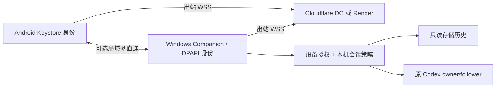
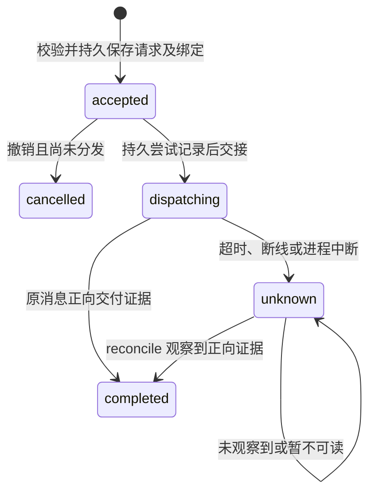

# 0.3.8 工作流与恢复语义

本文描述当前 Android + Windows Companion。字段见 [API](API.md)，组件见 [BACKEND](BACKEND.md)；旧 loopback 实验与当前产品能力需分开理解。

中继承载手机与电脑之间的内部 TLS 字节。WSS 先验证云端域名/证书并检查路由凭据，内部 TLS 再固定电脑证书并认证手机。路由票据、配对证明、会话授权分别校验。手机 profile ID 由电脑身份和手机证书指纹计算，排除 IP/端口。

## 首次初始化与配对

1. Companion 离线生成 P-256 电脑身份和注册凭据，用当前 Windows 用户的 DPAPI 保护私钥及原始凭据。空策略与未配置中继均可启动。
2. 用户导入明确的本机 Codex 策略，配置自己的中继，将导出登记 JSON 放入后端 Secret。
3. 电脑创建 120 秒单次邀请；二维码绑定电脑证书、身份、候选路由及邀请秘密。手机生成自己的 Keystore 密钥。
4. `pair.begin` 将邀请绑定到一个 request ID 和精确手机证书，返回挑战及六位码。
5. 手机持久化待配对材料并签名证明；`pair.prove` 让请求进入电脑待确认列表。用户在电脑核对数字和范围，选择 `read` 及可选 `send`。
6. Android复用相同证明调用 `pair.prove` 查询/恢复，补交上次可能未到达的证明；协议另提供 `pair.status`。确认丢失时复用请求和密钥；已批准结果可在邀请到期后额外 600 秒内恢复。未批准邀请过期或重启后失效。

主机策略的 `send` 是能力上限；手机还需要对应 grant。增加主机权利不会自动扩大原手机授权。

## 历史与长回复

已认证手机用 `catalog` 取得获准读取的别名和能力，再用 `history` 分页。单个按需复用的只读 app-server 读取存储 turn，投影用户/助手文本与问题记录；完整命令/工具输出和附件不在本版投影范围。

页 revision 包含内容、状态和元数据，`ifRevision` 未变化时返回 `notModified`。长文本先返回约 2400 UTF-8 字节预览及绑定目标、内容 hash 的 `nextPart`；点击展开后用 `message` 续读，每次点击最多 8 个片段，仍有剩余可再次点击。同 ID 内容改变、游标过期或服务重启时重新加载，避免拼接不同版本。

每个连接身份缓存最多 64 页、2 MiB 明文容量，文件实际使用 AES-GCM/Keystore；空间不足可淘汰缓存。缓存不能证明在线授权、发送就绪或消息送达。前台通常每 15 秒刷新，失败退避至 60 秒；展开较旧页面时暂停自动刷新。

## 发送与确认丢失

`completed` 表示消息交付有证据；模型状态另见 `result.turnStatus`，不意味着所有工具动作已经完成。

首次写业务请求前可以选择其它候选通路；一旦可能写出，就保留原 operation ID，不通过换路、新 ID 或重连自动重放。设备、ID、文本摘要和原目标持久绑定；同 ID 改内容产生冲突。重启将尚为 `dispatching` 的操作置为 `unknown`。

发送由受控 Node worker 调用已有 owner；最后交接许可与撤销串行，结果释放前再次鉴权。持久记录与上游之间仍有崩溃窗口，因此使用未知结果核对，不宣称任意副作用全局 exactly-once。

## 切网、路由迁移和撤销

Android 默认网络变化会关闭旧承载、重新建立内部 TLS，并恢复只读核对。VPN 切换后的 DNS、WSS、代理认证和托管冷启动均影响恢复时间；尚无覆盖所有真实网络组合的持续运行结论。

更换中继时，电脑给原设备生成 120 秒签名连接更新码；手机核对原电脑签名后更新路由，保留身份和 operation ID。设备票据有期限，日常响应续期；超期可通过原局域网认证或连接更新码恢复。

本机撤销会持久禁用身份、取消未分发队列、更新 TLS 信任并关闭已识别连接。新 host 通道同步云端撤销状态；电脑自己的鉴权独立生效。已交接任务不会自动取消，已下载的数据无法由撤销收回。

## 交互测试

手机支持读取及受限文本发送。命令审批有本地适配实验，尚未与手机持久恢复 API 集成；历史问题也不是可提交的实时表单。指定测试会话可启用 `send` 和 `allowFreeText`，原运行时沙箱、审批继续生效。真实测试策略、会话 ID、手机 grants、日志和备份不进入公开源码或 Release。
